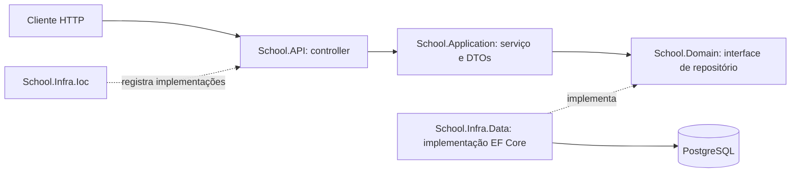

# SchoolApp — guia de arquitetura

Projeto de estudo de uma API escolar em **ASP.NET Core / .NET 10**, com Entity Framework Core e PostgreSQL. Este README explica o código existente e serve como material de consulta durante a evolução do projeto.

## Estado atual

As cinco entidades possuem repositórios, DTOs, interfaces de serviço e serviços CRUD registrados na injeção de dependência. A camada HTTP ainda contém apenas o exemplo `WeatherForecastController`: **os serviços escolares ainda não possuem endpoints**. Também não há autenticação, autorização por perfil, paginação ou tratamento global das exceções de negócio.

## Como as camadas se relacionam



O fluxo HTTP acima representa a organização a seguir ao criar os controllers escolares. Hoje os serviços já podem ser chamados diretamente pelo código, mas só o exemplo de previsão do tempo está publicado via HTTP.

A separação é uma arquitetura em camadas com inversão de dependência: a aplicação conhece contratos de persistência, sem depender do EF Core. Isso facilita testar regras sem banco e trocar a implementação de armazenamento. As entidades atuais são classes de dados; as regras implementadas ficam nos serviços.

| Projeto/pasta | Responsabilidade e exemplos |
| --- | --- |
| `School.API` | Entrada HTTP e inicialização da aplicação. |
| `School.API/Controllers` | Receber requisições, chamar serviços e definir respostas HTTP. Atualmente contém apenas WeatherForecast. |
| `School.API/Program.cs` | Montar o container de dependências e o pipeline de middleware; registrar controllers, infraestrutura e OpenAPI. |
| `School.API/Properties` | Perfis locais de execução, quando presentes. |
| `School.API/appsettings*.json` | Configurações por ambiente. Credenciais reais devem ficar fora do Git. |
| `School.Application/DTO` | Contratos de entrada e saída, separados por entidade e operação. |
| `School.Application/Interfaces` | Contratos dos casos de uso, como `ICourseService`. |
| `School.Application/Services` | Mapeamento explícito entre entidades e DTOs e coordenação dos repositórios. ServiceValidation permanece disponível, mas não é chamado pelos serviços atuais. |
| `School.Domain/Entities` | Modelo escolar: Course, SchoolClass, User, Enrollment e Grade. |
| `School.Domain/Interfaces` | Contratos dos repositórios. Definem o que a aplicação precisa armazenar e consultar. |
| `School.Infra.Data/Context` | `ApplicationDbContext`: sessão de acesso ao banco, DbSets e aplicação dos mapeamentos. |
| `School.Infra.Data/EntitiesConfiguration` | Fluent API: chaves, limites, obrigatoriedade, relacionamentos e comportamento de exclusão física. |
| `School.Infra.Data/Repositories` | Consultas e gravações com EF Core. `SaveChangesAsync` efetiva as alterações no banco. |
| `School.Infra.Data/Migrations` | Histórico versionado da estrutura do banco. O snapshot representa o último modelo gerado. |
| `School.Infra.Ioc` | Liga interfaces às implementações e configura o provedor PostgreSQL. |
| `School.Application.Tests` | Verificações executáveis dos serviços com repositórios em memória, sem banco e sem framework de testes externo. |
| `SchoolApp.sln` | Agrupa os projetos para a IDE e os comandos de compilação. |
| `bin` e `obj` | Arquivos gerados na compilação/restauração; não são código de negócio. |

Referências de projeto: `Application → Domain`; `Infra.Data → Domain`; `Infra.Ioc → Application + Infra.Data`; `API → Infra.Ioc`. O domínio não precisa conhecer HTTP ou EF Core.

## Modelo escolar

- **Course**: curso com nome e descrição; possui turmas.
- **SchoolClass**: turma vinculada a um curso por `CourseId`. Matrículas usam SchoolClassId e a navegação SchoolClass; cursos e o DbContext usam a coleção SchoolClasses.
- **User**: usuário com nome, e-mail, perfil e dados derivados da senha.
- **Enrollment**: matrícula que associa usuário e turma, com início, expiração e indicador de atividade.
- **Grade**: nota vinculada à matrícula e ao curso, com data de avaliação e aprovação.

`Id` é a chave primária. Campos como `CourseId` são chaves estrangeiras. Propriedades de navegação como `Course` e `Enrollments` permitem representar os relacionamentos em objetos; elas não são automaticamente carregadas por todas as consultas. Os DTOs comuns retornam campos escalares; os DTOs detalhados de turma e matrícula incluem objetos de leitura dos relacionamentos.

## Entidade, DTO, interface, serviço e repositório

Uma **entidade** representa o modelo persistido. Um **DTO** representa os dados aceitos ou devolvidos por uma operação. Por exemplo, `CoursePostDto` recebe nome e descrição; `CoursePutDto` também exige ID; `CourseGetDto` devolve a identificação gerada. Os DTOs não expõem `Deleted` nem as coleções de navegação.

Uma **interface** define um contrato. `ICourseService` descreve os casos de uso; `ICourseRepository` descreve o acesso aos dados. O **serviço** decide se a operação é válida e converte os dados. O **repositório** usa o contexto para persistir. Um controller futuro deve depender de `ICourseService`, sem instanciar repositórios ou contextos manualmente.

### Métodos dos serviços

Os serviços seguem o padrão de EnrollmentService: recebem os DTOs, criam entidades com inicializadores, chamam o repositório e montam explicitamente o DTO de resposta em cada operação.

| Método | Comportamento |
| --- | --- |
| GetByIdAsync(id) | Consulta o repositório e retorna DTO ou null quando ausente. Turmas e matrículas retornam DTOs detalhados com relacionamentos. |
| GetAllAsync() | Mapeia os registros devolvidos pelo repositório para uma lista de DTOs, sem filtro adicional no serviço. Matrículas usam EnrollmentGetDetailDto. |
| AddAsync(dto) | Cria a entidade a partir do DTO e retorna os valores persistidos. |
| UpdateAsync(dto) | Cria uma entidade com os campos de entrada e delega a atualização ao repositório. Usuários recebem o ID separadamente: UpdateAsync(userId, dto). |
| DeleteAsync(id) | Delega a exclusão ao repositório e retorna DTO ou null. |

Task e await representam operações assíncronas de acesso à persistência. As respostas são construídas com os dados devolvidos pelo repositório, inclusive IDs gerados.

### Mapeamento e regras atuais

- Os serviços não executam Data Annotations, normalização com Trim ou validação geral de IDs e vínculos. As anotações continuam nos DTOs para validação na futura camada HTTP; chamadas diretas não as executam automaticamente.
- Turmas associam CourseId; a consulta individual retorna SchoolClassGetDetailDto com o curso. O repositório carrega essa navegação com Include.
- Matrículas geram EnrollmentDate em UTC e começam com IsActive igual a true. O serviço de referência recebe apenas o repositório de matrículas e retorna usuário e turma nas consultas detalhadas. O repositório carrega essas navegações.
- Na atualização, notas derivam CourseId pela matrícula e sua turma (SchoolClassId). A ausência desses vínculos gera InvalidOperationException. A criação atual gera DateGrade com DateTime.Now e define IsApproved quando GradeValue é maior ou igual a 60.
- Usuários recebem perfil Student na criação. UpdateAsync recebe userId separado do DTO. Criação e atualização geram hash PBKDF2-SHA256 com 600.000 iterações, salt aleatório de 16 bytes e hash de 32 bytes. As leituras não retornam credenciais.
- Os repositórios de curso, turma, usuário e nota buscam a entidade existente durante a atualização e alteram somente os campos permitidos; retornam null quando ausente. Isso preserva Deleted, perfil do usuário, data e aprovação da nota. O EnrollmentService e sua atualização de referência foram preservados; seu repositório ainda usa Update da entidade recebida, que grava também os valores padrão dos campos omitidos.

### Exclusão lógica e limitações

Os repositórios marcam Deleted como true. Seguindo o serviço de referência, os serviços retornam os registros fornecidos pelo repositório, sem ocultar excluídos nem bloquear sua atualização. Uma política uniforme de filtragem e validação permanece como evolução futura.

As exceções ainda não são convertidas globalmente em respostas HTTP. Não há controllers escolares, autenticação, autorização nem política completa de exclusão de relacionamentos.

## Injeção de dependência e pipeline

`AddScoped<ICourseService, CourseService>()` informa ao ASP.NET Core qual implementação criar quando alguém solicitar a interface. O tempo de vida scoped compartilha a instância dentro de um escopo, normalmente uma requisição HTTP. Os repositórios e o `DbContext` seguem esse tempo de vida.

Em `Program.cs`, `AddControllers` registra a infraestrutura dos controllers, `AddInfrastructure` registra serviços/repositórios/banco e `AddOpenApi` registra a geração do contrato HTTP. Depois de `Build`, `MapOpenApi` publica o documento em desenvolvimento, `UseHttpsRedirection` redireciona para HTTPS, `UseAuthorization` participa do pipeline de autorização e `MapControllers` mapeia as rotas. A presença de `UseAuthorization` sozinha não configura login ou proteção dos endpoints.

## Como implementar um endpoint ASP.NET Core

Para expor cursos, crie um `CoursesController` com `[ApiController]`, `[Route("api/courses")]` e uma dependência de `ICourseService` recebida no construtor. `[ApiController]` faz a validação automática do modelo de entrada; as regras que dependem de outros registros continuam no serviço.

| Operação sugerida | Método HTTP | Resposta esperada |
| --- | --- | --- |
| Listar | `GET /api/courses` | `200 OK` com lista |
| Consultar | `GET /api/courses/{id}` | `200 OK` ou `404 Not Found` |
| Criar | `POST /api/courses` | `201 Created`, preferencialmente com `CreatedAtAction` |
| Atualizar | `PUT /api/courses/{id}` | `200 OK` ou `204 No Content`; `404` quando ausente |
| Excluir | `DELETE /api/courses/{id}` | `204 No Content`; `404` quando ausente |

Essas rotas são uma orientação de implementação, não endpoints já disponíveis. Ao implementar PUT, confira se o ID da rota coincide com o DTO. Converta erros de validação em `400 Bad Request`, use `ProblemDetails` para respostas consistentes e preserve detalhes técnicos nos logs. Autenticação e autorização devem ser definidas antes de publicar operações de usuários e perfis.

Para adicionar uma funcionalidade: modele a entidade e seus relacionamentos; crie/ajuste a configuração EF; gere uma migration se o esquema mudar; defina DTOs e contrato do serviço; implemente regras e persistência; registre as dependências; exponha o controller; teste regras e respostas; atualize este README no mesmo commit.

## Executar localmente

Pré-requisitos: SDK .NET 10, PostgreSQL e a ferramenta `dotnet-ef` compatível com EF Core 10 para migrations.

```powershell
dotnet restore SchoolApp.sln
dotnet build SchoolApp.sln
# Exemplo: substitua os valores apenas no ambiente local.
$env:ConnectionStrings__DefaultConnection = "Host=localhost;Database=school;Username=postgres;Password=SUA_SENHA"
dotnet ef database update --project School.Infra.Data --startup-project School.API
dotnet run --project School.API
```

O ASP.NET Core combina configurações de `appsettings.json`, ambiente e outras fontes. Também é possível usar User Secrets no projeto API. Não versione senhas reais. Consulte a URL exibida no terminal; em desenvolvimento o documento OpenAPI fica em `/openapi/v1.json`.

Migrations são alterações versionadas do esquema, não alterações automáticas causadas por editar uma entidade:

```powershell
dotnet ef migrations add NomeDaAlteracao --project School.Infra.Data --startup-project School.API
# Revise o código gerado antes de aplicar.
dotnet ef database update --project School.Infra.Data --startup-project School.API
```

## Verificar os serviços

```powershell
dotnet run --project School.Application.Tests
```

O executável retorna erro se uma verificação falhar. ServiceChecks.cs verifica mapeamentos, consultas detalhadas, retornos ausentes, delegação ao repositório e geração de hash com repositórios em memória. Não acessa PostgreSQL e não substitui testes de integração ou HTTP.

## Manutenção deste guia

Este é um documento vivo, atualizado junto das mudanças do projeto; não existe geração automática deste arquivo. Cada alteração de arquitetura, pasta, contrato, regra, endpoint ou configuração deve incluir a revisão da seção correspondente. Descreva como implementado apenas o que o código já faz e mantenha propostas claramente identificadas.

Na validação desta implementação, a compilação apontou avisos já presentes: conflito entre versões transitivas de `Microsoft.EntityFrameworkCore.Relational` e vulnerabilidade reportada pelo NuGet em `Microsoft.OpenApi` 2.0.0. A atualização/alinhamento dessas dependências permanece pendente. A compilação não substitui testes de integração com PostgreSQL.

A migration RenameClassToSchoolClass renomeia a tabela Classes para SchoolClasses e a coluna ClassId para SchoolClassId, com seus índices e restrições, preservando os registros. As migrations anteriores mantêm os nomes históricos. Para atualizar um banco existente, execute dotnet ef database update --project School.Infra.Data --startup-project School.API; as migrations de renomeação foram aplicadas com sucesso ao banco configurado nesta execução.

O nome final da tabela é SchoolClass (singular), definido explicitamente por ToTable em SchoolClassConfiguration. A migration UseSchoolClassTableName renomeia SchoolClasses para SchoolClass e ajusta as restrições e o índice; o DbSet e as coleções em C# permanecem SchoolClasses. As duas migrations de renomeação foram aplicadas com dotnet ef database update --project School.Infra.Data --startup-project School.API, preservando os registros existentes.
