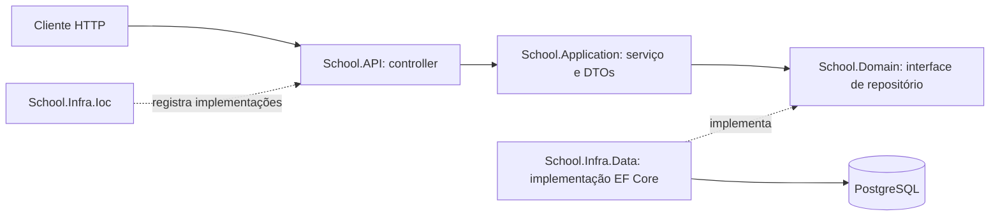

# SchoolApp — guia de arquitetura

Projeto de estudo de uma API escolar em **ASP.NET Core / .NET 10**, com Entity Framework Core e PostgreSQL. Este README explica o código existente e serve como material de consulta durante a evolução do projeto.

## Estado atual

As cinco entidades possuem repositórios, DTOs, interfaces de serviço e serviços CRUD registrados na injeção de dependência. A camada HTTP ainda contém apenas o exemplo `WeatherForecastController`: **os serviços escolares ainda não possuem endpoints**. Também não há autenticação, autorização por perfil, paginação ou tratamento global das exceções de negócio.

## Como as camadas se relacionam



O fluxo HTTP acima representa a organização a seguir ao criar os controllers escolares. Hoje os serviços já podem ser chamados diretamente pelo código, mas só o exemplo de previsão do tempo está publicado via HTTP.

A separação é uma arquitetura em camadas com inversão de dependência: a aplicação conhece contratos de persistência, sem depender do EF Core. Isso facilita testar regras sem banco e trocar a implementação de armazenamento. As entidades atuais são classes de dados; as regras implementadas ficam nos serviços.

| Projeto/pasta | Responsabilidade e exemplos |
| --- | --- |
| `School.API` | Entrada HTTP e inicialização da aplicação. |
| `School.API/Controllers` | Receber requisições, chamar serviços e definir respostas HTTP. Atualmente contém apenas WeatherForecast. |
| `School.API/Program.cs` | Montar o container de dependências e o pipeline de middleware; registrar controllers, infraestrutura e OpenAPI. |
| `School.API/Properties` | Perfis locais de execução, quando presentes. |
| `School.API/appsettings*.json` | Configurações por ambiente. Credenciais reais devem ficar fora do Git. |
| `School.Application/DTO` | Contratos de entrada e saída, separados por entidade e operação. |
| `School.Application/Interfaces` | Contratos dos casos de uso, como `ICourseService`. |
| `School.Application/Services` | Validação, regras, mapeamento entre entidades e DTOs e coordenação dos repositórios. `ServiceValidation` compartilha a validação básica. |
| `School.Domain/Entities` | Modelo escolar: Course, Class, User, Enrollment e Grade. |
| `School.Domain/Interfaces` | Contratos dos repositórios. Definem o que a aplicação precisa armazenar e consultar. |
| `School.Infra.Data/Context` | `ApplicationDbContext`: sessão de acesso ao banco, DbSets e aplicação dos mapeamentos. |
| `School.Infra.Data/EntitiesConfiguration` | Fluent API: chaves, limites, obrigatoriedade, relacionamentos e comportamento de exclusão física. |
| `School.Infra.Data/Repositories` | Consultas e gravações com EF Core. `SaveChangesAsync` efetiva as alterações no banco. |
| `School.Infra.Data/Migrations` | Histórico versionado da estrutura do banco. O snapshot representa o último modelo gerado. |
| `School.Infra.Ioc` | Liga interfaces às implementações e configura o provedor PostgreSQL. |
| `School.Application.Tests` | Verificações executáveis dos serviços com repositórios em memória, sem banco e sem framework de testes externo. |
| `SchoolApp.sln` | Agrupa os projetos para a IDE e os comandos de compilação. |
| `bin` e `obj` | Arquivos gerados na compilação/restauração; não são código de negócio. |

Referências de projeto: `Application → Domain`; `Infra.Data → Domain`; `Infra.Ioc → Application + Infra.Data`; `API → Infra.Ioc`. O domínio não precisa conhecer HTTP ou EF Core.

## Modelo escolar

- **Course**: curso com nome e descrição; possui turmas.
- **Class**: turma vinculada a um curso por `CourseId`.
- **User**: usuário com nome, e-mail, perfil e dados derivados da senha.
- **Enrollment**: matrícula que associa usuário e turma, com início, expiração e indicador de atividade.
- **Grade**: nota vinculada à matrícula e ao curso, com data de avaliação e aprovação.

`Id` é a chave primária. Campos como `CourseId` são chaves estrangeiras. Propriedades de navegação como `Course` e `Enrollments` permitem representar os relacionamentos em objetos; elas não são automaticamente carregadas por todas as consultas. Os DTOs atuais retornam campos escalares para evitar ciclos e exposição desnecessária.

## Entidade, DTO, interface, serviço e repositório

Uma **entidade** representa o modelo persistido. Um **DTO** representa os dados aceitos ou devolvidos por uma operação. Por exemplo, `CoursePostDto` recebe nome e descrição; `CoursePutDto` também exige ID; `CourseGetDto` devolve a identificação gerada. Os DTOs não expõem `Deleted` nem as coleções de navegação.

Uma **interface** define um contrato. `ICourseService` descreve os casos de uso; `ICourseRepository` descreve o acesso aos dados. O **serviço** decide se a operação é válida e converte os dados. O **repositório** usa o contexto para persistir. Um controller futuro deve depender de `ICourseService`, sem instanciar repositórios ou contextos manualmente.

### Métodos dos serviços

Todos os serviços seguem o mesmo contrato:

| Método | Comportamento |
| --- | --- |
| `GetByIdAsync(id)` | Exige ID positivo; devolve DTO ou `null` se ausente/excluído. |
| `GetAllAsync()` | Devolve lista de DTOs dos registros não excluídos; pode ser vazia. |
| `AddAsync(dto)` | Valida entrada e vínculos aplicáveis, cria entidade e retorna o DTO persistido. |
| `UpdateAsync(dto)` | Valida entrada, busca entidade existente e altera os campos permitidos. Retorna `null` se ausente/excluída. |
| `DeleteAsync(id)` | Exige ID positivo e chama o repositório para marcar `Deleted = true`. Retorna `null` se ausente/já excluída. |

`Task<T>` representa um resultado assíncrono. `await` permite aguardar I/O sem bloquear a thread durante a espera. O sufixo `Async` comunica essa característica. `ToDto` centraliza o mapeamento de saída; `Select` aplica esse mapeamento a cada elemento e `Where` filtra registros excluídos.

### Validações e regras implementadas

- Data Annotations (`Required`, `MaxLength`, `Range`, `EmailAddress`, `MinLength`) validam os DTOs. Os serviços chamam `Validator.ValidateObject`, portanto a validação também ocorre fora de um controller.
- Nomes e descrições são aparados com `Trim`. IDs precisam ser positivos. Campos obrigatórios não aceitam texto em branco.
- Turmas exigem um curso existente e não excluído.
- Matrículas exigem usuário e turma existentes e não excluídos. A expiração deve ser posterior à matrícula, e ambas as datas devem estar em UTC.
- Notas exigem curso e matrícula existentes e não excluídos; o curso deve corresponder ao curso da turma da matrícula. A nota não pode ser negativa e a data de avaliação deve ser válida e UTC.
- Não foi definida uma escala máxima de notas nem uma média de aprovação. `IsApproved` continua sendo informado pelo chamador. `IsActive` também é explícito, sem cálculo automático pela data.
- Usuários exigem e-mail válido, perfil e senha de no mínimo oito caracteres na criação. Na atualização, `Password = null` preserva a senha; uma nova senha passa pela mesma validação mínima.
- Senhas usam PBKDF2-SHA256 com 600.000 iterações, salt aleatório de 16 bytes e hash de 32 bytes. Os DTOs de leitura não retornam senha, hash ou salt. Isso ainda não implementa login nem controle de permissões sobre `Profile`.

Entradas inválidas geram `ValidationException`, IDs inválidos geram `ArgumentOutOfRangeException` e argumentos nulos geram `ArgumentNullException`. Essas exceções ainda não são convertidas globalmente em respostas HTTP. Falhas de infraestrutura também não devem ser expostas com detalhes internos ao cliente.

### Exclusão lógica

Excluir marca `Deleted = true`, preservando a linha no banco. Os serviços ocultam esses registros nas consultas e impedem sua atualização. Os repositórios atuais ainda consultam todas as linhas; o filtro da listagem ocorre em memória no serviço. Uma evolução para grandes volumes é filtrar no banco e paginar.

A exclusão lógica não exclui automaticamente registros relacionados. Excluir um curso, por exemplo, não exclui suas turmas. As validações verificam os vínculos diretos descritos acima; não existe uma política completa de propagação ou bloqueio de exclusões. Essa política deve ser definida antes de ampliar as regras.

## Injeção de dependência e pipeline

`AddScoped<ICourseService, CourseService>()` informa ao ASP.NET Core qual implementação criar quando alguém solicitar a interface. O tempo de vida scoped compartilha a instância dentro de um escopo, normalmente uma requisição HTTP. Os repositórios e o `DbContext` seguem esse tempo de vida.

Em `Program.cs`, `AddControllers` registra a infraestrutura dos controllers, `AddInfrastructure` registra serviços/repositórios/banco e `AddOpenApi` registra a geração do contrato HTTP. Depois de `Build`, `MapOpenApi` publica o documento em desenvolvimento, `UseHttpsRedirection` redireciona para HTTPS, `UseAuthorization` participa do pipeline de autorização e `MapControllers` mapeia as rotas. A presença de `UseAuthorization` sozinha não configura login ou proteção dos endpoints.

## Como implementar um endpoint ASP.NET Core

Para expor cursos, crie um `CoursesController` com `[ApiController]`, `[Route("api/courses")]` e uma dependência de `ICourseService` recebida no construtor. `[ApiController]` faz a validação automática do modelo de entrada; as regras que dependem de outros registros continuam no serviço.

| Operação sugerida | Método HTTP | Resposta esperada |
| --- | --- | --- |
| Listar | `GET /api/courses` | `200 OK` com lista |
| Consultar | `GET /api/courses/{id}` | `200 OK` ou `404 Not Found` |
| Criar | `POST /api/courses` | `201 Created`, preferencialmente com `CreatedAtAction` |
| Atualizar | `PUT /api/courses/{id}` | `200 OK` ou `204 No Content`; `404` quando ausente |
| Excluir | `DELETE /api/courses/{id}` | `204 No Content`; `404` quando ausente |

Essas rotas são uma orientação de implementação, não endpoints já disponíveis. Ao implementar PUT, confira se o ID da rota coincide com o DTO. Converta erros de validação em `400 Bad Request`, use `ProblemDetails` para respostas consistentes e preserve detalhes técnicos nos logs. Autenticação e autorização devem ser definidas antes de publicar operações de usuários e perfis.

Para adicionar uma funcionalidade: modele a entidade e seus relacionamentos; crie/ajuste a configuração EF; gere uma migration se o esquema mudar; defina DTOs e contrato do serviço; implemente regras e persistência; registre as dependências; exponha o controller; teste regras e respostas; atualize este README no mesmo commit.

## Executar localmente

Pré-requisitos: SDK .NET 10, PostgreSQL e a ferramenta `dotnet-ef` compatível com EF Core 10 para migrations.

```powershell
dotnet restore SchoolApp.sln
dotnet build SchoolApp.sln
# Exemplo: substitua os valores apenas no ambiente local.
$env:ConnectionStrings__DefaultConnection = "Host=localhost;Database=school;Username=postgres;Password=SUA_SENHA"
dotnet ef database update --project School.Infra.Data --startup-project School.API
dotnet run --project School.API
```

O ASP.NET Core combina configurações de `appsettings.json`, ambiente e outras fontes. Também é possível usar User Secrets no projeto API. Não versione senhas reais. Consulte a URL exibida no terminal; em desenvolvimento o documento OpenAPI fica em `/openapi/v1.json`.

Migrations são alterações versionadas do esquema, não alterações automáticas causadas por editar uma entidade:

```powershell
dotnet ef migrations add NomeDaAlteracao --project School.Infra.Data --startup-project School.API
# Revise o código gerado antes de aplicar.
dotnet ef database update --project School.Infra.Data --startup-project School.API
```

## Verificar os serviços

```powershell
dotnet run --project School.Application.Tests
```

O executável retorna erro se uma verificação falhar. Cobre validações, atualização, exclusão lógica nos cinco serviços, vínculos entre curso/turma/matrícula/nota e geração/preservação/troca da senha. Não acessa PostgreSQL e não substitui testes de integração ou HTTP.

## Manutenção deste guia

Este é um documento vivo, atualizado junto das mudanças do projeto; não existe geração automática deste arquivo. Cada alteração de arquitetura, pasta, contrato, regra, endpoint ou configuração deve incluir a revisão da seção correspondente. Descreva como implementado apenas o que o código já faz e mantenha propostas claramente identificadas.

Na validação desta implementação, a compilação apontou avisos já presentes: conflito entre versões transitivas de `Microsoft.EntityFrameworkCore.Relational` e vulnerabilidade reportada pelo NuGet em `Microsoft.OpenApi` 2.0.0. A atualização/alinhamento dessas dependências permanece pendente. A compilação não substitui testes de integração com PostgreSQL.
