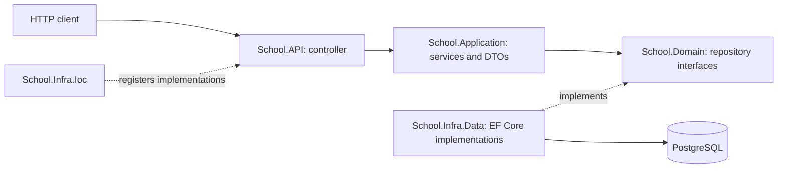

# SchoolApp — Architecture Guide

An educational school API built with **ASP.NET Core / .NET 10**, Entity Framework Core, and PostgreSQL. This guide explains the existing code and the reasoning behind its structure.

## Current implementation

The five school entities have repositories, DTOs, service interfaces, CRUD services, and HTTP controllers: courses, school classes, users, enrollments, and grades. User registration and login issue JWTs, and a test route declares role-based authorization. Pagination and a comprehensive access-control policy are not implemented. Global exception handling exists, with the HTTP status limitation explained below.

## Architecture and dependency flow



Controllers receive request DTOs and call application services through interfaces. Services coordinate operations and map entities to response DTOs. Repositories handle persistence through EF Core.

This is a layered architecture with dependency inversion: the application depends on persistence contracts rather than EF Core. Services can therefore be checked without a database, and persistence implementations can change independently. The current entities primarily hold data; application rules reside in services. Authentication uses a separate domain contract implemented in infrastructure and consumed by the user controller.

| Project or folder | Responsibility |
| --- | --- |
| `School.API` | HTTP entry point and application startup. |
| `School.API/Controllers` | Course, SchoolClass, User, Enrollment, and Grade request handling. |
| `School.API/Models` | HTTP-specific models, including `UserLogin`. |
| `School.API/Middleware` | Global exception handling. |
| `School.API/Program.cs` | Dependency composition and middleware pipeline. |
| `School.API/Properties` | Local launch profiles. |
| `School.API/appsettings*.json` | Environment configuration. Keep real credentials outside version control. |
| `School.Application/DTO` | Input and output contracts grouped by entity and operation. |
| `School.Application/Interfaces` | Use-case contracts such as `ICourseService`. |
| `School.Application/Services` | Explicit entity/DTO mapping and repository coordination. |
| `School.Application/Exceptions` | Application exceptions such as `NotFoundException` and `BadRequestException`. |
| `School.Domain/Entities` | Course, SchoolClass, User, Enrollment, and Grade data models. |
| `School.Domain/Interfaces` | Repository contracts. |
| `School.Domain/Account` | The `IAuthenticate` authentication contract. |
| `School.Infra.Data/Context` | `ApplicationDbContext`, DbSets, and model configuration. |
| `School.Infra.Data/EntitiesConfiguration` | Fluent API keys, constraints, relationships, and physical deletion behavior. |
| `School.Infra.Data/Repositories` | EF Core queries and persistence through `SaveChangesAsync`. |
| `School.Infra.Data/Identity` | Credential verification, user lookup, and JWT generation. |
| `School.Infra.Data/Migrations` | Versioned database schema changes and model snapshot. |
| `School.Infra.Ioc` | Service/repository registrations, PostgreSQL provider, and JWT validation settings. |
| `School.Application.Tests` | Executable service checks with a top-level entry point in `Program.cs` and in-memory repositories in `ServiceChecks.cs`. |
| `SchoolApp.sln` | Solution used by the IDE and build commands. |
| `bin` and `obj` | Generated build and restore artifacts. |

Project references follow `Application → Domain`, `Infra.Data → Domain`, `Infra.Ioc → Application + Infra.Data`, and `API → Infra.Ioc`. The domain does not need HTTP or EF Core dependencies.

## School model

- **Course** has a name and description and groups school classes.
- **SchoolClass** belongs to a course through `CourseId`. Enrollments refer to it through `SchoolClassId` and the `SchoolClass` navigation property.
- **User** stores a name, email, role, password hash, and salt.
- **Enrollment** links a user to a school class and stores enrollment/expiration dates and an activity flag.
- **Grade** relates to an enrollment and a course and stores the grade value, assessment date, and approval flag.

`Id` is a primary key; fields such as `CourseId` are foreign keys. Navigation properties represent relationships in objects, but queries do not automatically load all relationships. Standard DTOs expose scalar fields; detailed school-class and enrollment DTOs include related read models.

The school-class table is explicitly named `SchoolClass` through `ToTable`. C# collections and the DbSet remain named `SchoolClasses`. Historical migrations use the earlier names: `RenameClassToSchoolClass` renames `Classes` and `ClassId`, while `UseSchoolClassTableName` changes the table from `SchoolClasses` to `SchoolClass`. These migrations are intended to preserve existing records while updating names, indexes, and constraints.

## Entities, DTOs, services, and repositories

An **entity** represents persisted data. A **DTO** describes the data accepted or returned by an operation. For example, `CoursePostDto` accepts a name and description, `CoursePutDto` also carries an ID, and `CourseGetDto` returns the persisted identifier. Response DTOs do not expose password hashes or salts; school DTOs do not expose the `Deleted` flag or entire navigation collections.

An **interface** defines a contract. `ICourseService` describes application operations, while `ICourseRepository` describes persistence operations. A **service** coordinates the operation and maps data; a **repository** uses the database context to query and save entities. Controllers receive dependencies through constructor injection rather than creating repositories or contexts themselves.

### Service operations

| Method | Behavior |
| --- | --- |
| `GetByIdAsync(id)` | Returns a DTO or throws `NotFoundException`. School classes and enrollments return detailed DTOs. |
| `GetAllAsync()` | Maps repository results into a list without additional service filtering. Enrollments use `EnrollmentGetDetailDto`. An empty list is valid. |
| `AddAsync(dto)` | Builds an entity from the DTO and returns persisted values, including its generated ID. |
| `UpdateAsync(dto)` | Delegates field updates to the repository and maps the result. Users instead use `UpdateAsync(userId, dto)`. |
| `DeleteAsync(id)` | Delegates soft deletion and returns a DTO, or throws `NotFoundException` if absent. |

`Task` and `await` represent asynchronous persistence operations. Some interface return types remain nullable for compatibility, although missing-record paths throw exceptions.

### Current rules and mapping behavior

- Services do not automatically execute Data Annotations, trim input, or apply a general validation policy for IDs and relationships. HTTP requests use `[ApiController]`, which validates annotated request models and returns `400 Bad Request` for invalid input. Direct service calls do not trigger that validation automatically.
- School-class creation and updates check that the course exists. Individual reads return `SchoolClassGetDetailDto`; the repository loads the course with `Include`.
- Enrollment creation sets `EnrollmentDate` to UTC and `IsActive` to `true`. Detailed queries include the user and school class. The service depends only on the enrollment repository.
- Grade creation sets `DateGrade` using `DateTime.Now` and marks values of at least 60 as approved. Creation does not explicitly resolve `CourseId`; updates derive it from the enrollment and school class and throw `NotFoundException` if either is missing.
- User creation assigns `Admin` when the repository reports no existing user and `Student` otherwise. Passwords are hashed with HMACSHA512, producing a 64-byte hash; the HMAC key is stored as the salt. Updates change name and email but do not apply the password supplied in the update DTO.
- Course, school-class, user, and grade repositories load the existing entity before updating allowed fields. This preserves other stored values, including `Deleted`, user role, and grade date/approval. Grade approval is not recalculated by the current update path.
- Enrollment updates first check existence, then pass a new entity to a repository that uses `Update`. Omitted fields can consequently be written with their default values.

### Soft deletion and exception handling

Repositories mark `Deleted` as `true`. CRUD services map whatever records the repositories return; they do not enforce a uniform policy for excluding deleted records or preventing updates to them. Authentication lookups explicitly exclude deleted users.

All five services throw `School.Application.Exceptions.NotFoundException` for missing records during individual reads, updates, and deletions. `BadRequestException` is also available for invalid-input rules.

`ExceptionMiddleware` logs exceptions and generates a JSON error body. It identifies `NotFoundException` as 404, `BadRequestException` as 400, and `UnauthorizedAccessException` as 401 in that body. **The actual HTTP response status is still set to 500 for every caught exception.** Controller null checks do not handle service paths that throw first. Development responses include stack traces.

## Dependency injection, authentication, and pipeline

`AddScoped<ICourseService, CourseService>()` tells ASP.NET Core which implementation to provide for an interface. A scoped lifetime shares an instance within a scope, typically one HTTP request. Repositories and `ApplicationDbContext` also use scoped lifetimes.

`AddInfrastructure` configures PostgreSQL and registers application services, repositories, and `IAuthenticate`. It also registers JWT Bearer authentication with issuer, audience, lifetime, and signing-key validation, using `Jwt:Issuer`, `Jwt:Audience`, and `Jwt:SecretKey`.

`AuthenticateService` looks up active users by email without case sensitivity, verifies passwords using the stored HMACSHA512 salt/hash, and generates HMACSHA256-signed JWTs valid for one hour. Tokens include user ID, email, role, and a unique token identifier.

In `Program.cs`, `AddControllers` registers HTTP controllers and `AddSwaggerGen` configures OpenAPI with a Bearer security definition. Development mode exposes `/swagger/v1/swagger.json` and `/swagger`. The pipeline includes exception handling, HTTPS redirection, authorization, and controller mapping. There is no explicit `UseAuthentication` call in the source; the minimal hosting model can insert authentication middleware automatically when authentication services are registered. Runtime authorization behavior still needs HTTP integration verification.

Only `GET /api/User/route-test` currently declares `[Authorize(Roles = "Admin, Student")]`. The other CRUD actions do not declare authorization requirements, and the Swagger Bearer definition alone does not secure them.

## Implemented HTTP endpoints

School controllers use `[ApiController]` and `[Route("api/[controller]")]`. ASP.NET Core replaces `[controller]` with the class name without the `Controller` suffix.

| Resource | Base route | Creation DTO | Update DTO |
| --- | --- | --- | --- |
| Courses | `/api/Course` | `CoursePostDto` | `CoursePutDto` |
| School classes | `/api/SchoolClass` | `SchoolClassPostDto` | `SchoolClassPutDto` |
| Users | `/api/User` | `UserPostDto` | `UserPutDto` |
| Enrollments | `/api/Enrollment` | `EnrollmentPostDto` | `EnrollmentPutDto` |
| Grades | `/api/Grade` | `GradePostDto` | `GradePutDto` |

| Operation | Method and path | Current response |
| --- | --- | --- |
| List | `GET` on the base route | `200 OK` with a list, including an empty list. |
| Read | `GET /{id}` | `200 OK` with a DTO; missing records throw an exception. |
| Create | `POST` on the base route | `200 OK` with a DTO, except user registration, which returns a name and token. |
| Update | `PUT` on the base route; users use `PUT /api/User/{id}` | `200 OK` with the updated DTO; missing records throw an exception. |
| Delete | `DELETE /{id}` | `200 OK` with a DTO after soft deletion; missing records throw an exception. |

Course, school-class, enrollment, and grade updates take the ID from the request DTO. User updates take it from the route. Enrollment reads and individual school-class reads return detailed DTOs.

User-specific actions:

| Endpoint | Behavior |
| --- | --- |
| `POST /api/User` | Rejects an email already used by a non-deleted user with `400 Bad Request`; otherwise creates the user and returns a name and JWT. |
| `POST /api/User/login` | Accepts `UserLogin` with email and password. Returns a name and JWT on success, or `400 Bad Request` for an unknown email or incorrect password. |
| `GET /api/User/route-test` | Declares authorization for the `Admin` and `Student` roles and returns a confirmation message when allowed. |

JSON property names follow the API serializer's naming policy; registration and login currently construct responses using the source property name `Nome` for the user's name.

Invalid annotated request models produce `400 Bad Request` automatically. Service and persistence exceptions pass through the global exception middleware and are subject to its HTTP status limitation.

## Running locally

Prerequisites: the .NET 10 SDK, PostgreSQL, and a `dotnet-ef` tool version compatible with EF Core 10.

Configure the connection string and JWT settings locally before starting the API. The following PowerShell example uses placeholders; supply local values, including a sufficiently long signing secret for HMACSHA256.

```powershell
dotnet restore SchoolApp.sln
dotnet build SchoolApp.sln
$env:ConnectionStrings__DefaultConnection = "Host=localhost;Database=school;Username=postgres;Password=YOUR_PASSWORD"
$env:Jwt__Issuer = "school-api"
$env:Jwt__Audience = "school-client"
$env:Jwt__SecretKey = "REPLACE_WITH_A_RANDOM_SECRET_OF_AT_LEAST_32_BYTES"
dotnet ef database update --project School.Infra.Data --startup-project School.API
dotnet run --project School.API
```

ASP.NET Core combines `appsettings.json`, environment variables, and other configuration sources. User Secrets in the API project are another local option. Do not commit real passwords or JWT signing secrets. Use the URL printed by the application; Swagger is available when the environment is `Development`.

Migrations are versioned schema changes. Editing an entity does not automatically update an existing database:

```powershell
dotnet ef migrations add DescribeYourChange --project School.Infra.Data --startup-project School.API
# Review the generated migration before applying it.
dotnet ef database update --project School.Infra.Data --startup-project School.API
```

## Validation

The project validation commands are:

```powershell
dotnet run --project School.Application.Tests
dotnet build SchoolApp.sln
```

The test project is a console executable: `Program.cs` runs the checks using top-level statements, and `ServiceChecks.cs` supplies in-memory repository implementations. A failed assertion throws an exception and causes a nonzero exit code. The user repository fake implements `UserExistsAsync` using the same non-deleted-user criterion as persistence.

Validation after restoring the executable: `dotnet run --project School.Application.Tests` passed, and `dotnet build SchoolApp.sln` completed with zero errors and one existing `Microsoft.EntityFrameworkCore.Relational` version-conflict warning.

Active checks cover DTO mapping, detailed school-class queries, missing-record exceptions, repository delegation, password hashing, salt preservation during user updates, and the assignment of `Admin` to the first user and `Student` to subsequent users. They do not access PostgreSQL or replace database and HTTP integration tests.

## Future improvements

The following items are proposals rather than completed features:

- Apply a consistent validation and soft-deletion policy across services and repositories.
- Correct exception HTTP status codes and consider standard `ProblemDetails` responses.
- Use consistent creation responses such as `201 Created` with `CreatedAtAction`.
- Extend authorization requirements across school operations and verify them through HTTP integration tests.
- Add pagination and database integration coverage.
- Review dependency alignment and package audit warnings as part of maintenance.

## Maintaining this guide

This README is maintained manually. Update the corresponding sections whenever architecture, folders, contracts, rules, endpoints, execution, or validation change. Document an HTTP endpoint only when a matching controller action exists, and keep future proposals clearly identified.

When adding a feature, model the entity and relationships, configure EF Core, generate a migration if the schema changes, define DTOs and service contracts, implement application rules and persistence, register dependencies, expose the controller, validate behavior, and update this guide in the same change set.
